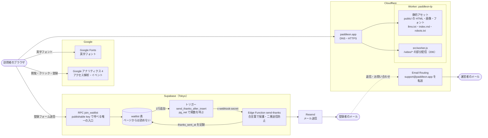
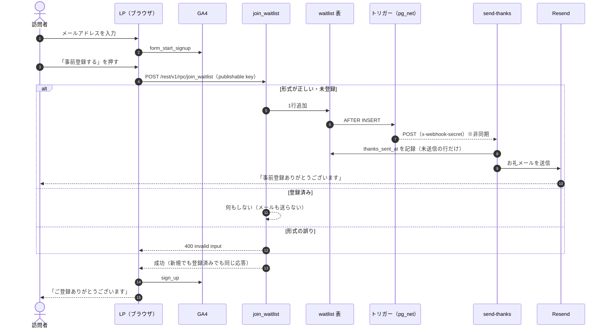
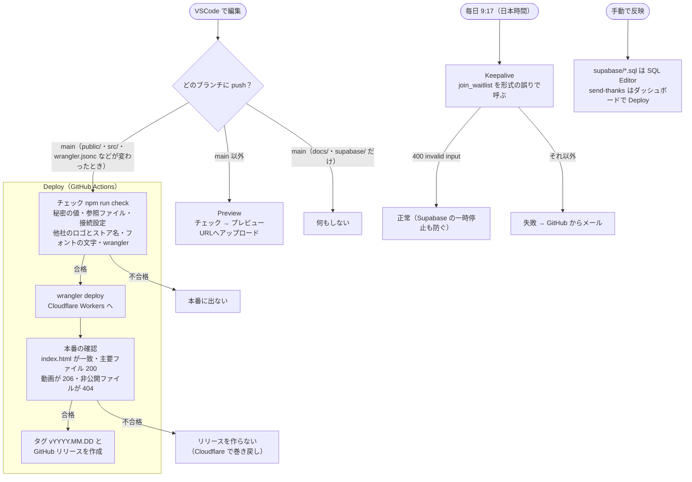
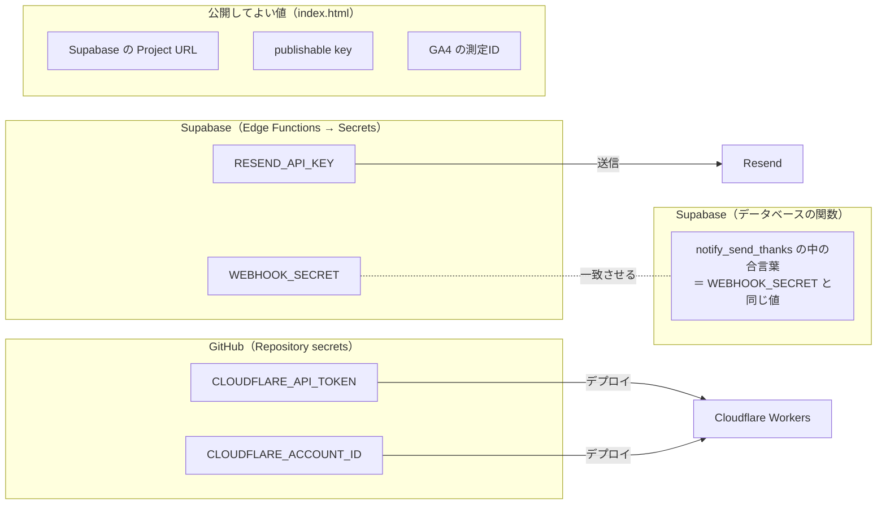

# システム構成

PADDLE ON 事前登録LP（https://paddleon.app/）の構成図です。図は Mermaid で書いているので、GitHub 上でそのまま図として表示されます。構成を変えたら、この図も合わせて直します。

## 全体の構成

| 部分 | 役割 | 場所 |
|---|---|---|
| 静的アセット | LP 本体。ビルドなしでそのまま配信 | `public/`、`wrangler.jsonc` |
| src/worker.js | 動画だけ部分配信（iPhone の Safari 用）。ほかのファイルは通らない | `src/worker.js` |
| join_waitlist | 登録の受け付け。新規でも登録済みでも同じ結果を返す | `supabase/waitlist.sql` |
| send_thanks_after_insert | 登録されたらお礼メールの関数を呼ぶ | `supabase/send_thanks_trigger.sql` |
| send-thanks | Resend でお礼メールを送る（1時間30通まで） | `supabase/functions/send-thanks/` |

## 登録からお礼メールまで

## デプロイと監視

## 秘密の値の置き場所

リポジトリに入れてよいのは「公開してよい値」だけです。ほかの値はチャットやファイルに書かず、各サービスの画面に直接入力します。
